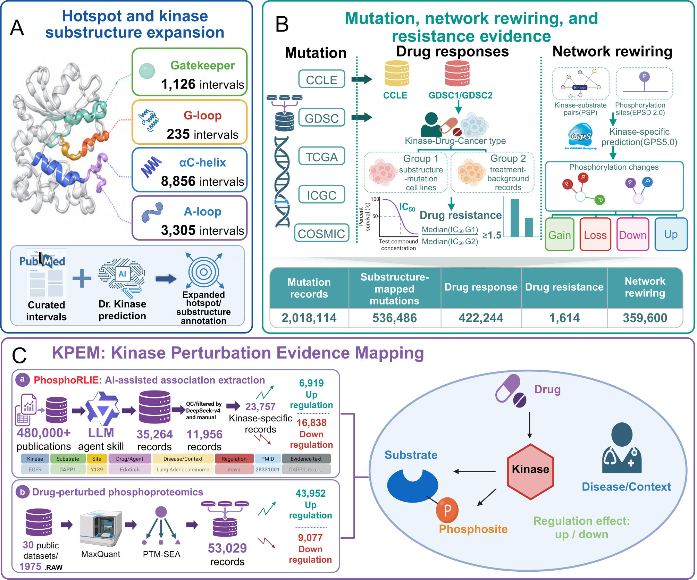

<h1 align="center">KinaseMD 2.0</h1>

<p align="center"><strong>Where can I look up human kinase mutations and drug response?</strong></p>

<p align="center">
  
  <a href="https://doi.org/10.1093/nar/gkag1170"></a>
</p>

<p align="center"><strong>English</strong> · <a href="./README.zh-CN.md">简体中文</a></p>

<p align="center">
  <a href="http://modinfor.com/KinaseMD/">Open database</a> ·
  <a href="#when-to-use">When to use it</a> ·
  <a href="#worked-examples">EGFR and RET examples</a> ·
  <a href="#coverage">Data coverage</a> ·
  <a href="#citation">Citation</a>
</p>

**KinaseMD 2.0** is a public database for investigating how human kinase mutations relate to inhibitor response and downstream phosphorylation. Start with a variant, inhibitor, or signaling observation and use the linked kinase pages to locate the affected structural region, compare drug-response measurements, and find evidence or predictions to follow up. The published 2.0 release covers 547 human protein kinases and includes 422,244 cell-line drug-response measurements. [Nucleic Acids Research paper](https://doi.org/10.1093/nar/gkag1170)

<p align="center">
  <a href="./assets/figure-1.jpg"></a>
</p>

<p align="center">
  <em>Figure 1. The three KinaseMD 2.0 workflows.</em> © 2026 The Authors.
  <a href="https://doi.org/10.1093/nar/gkag1170">Hu et al., Nucleic Acids Research</a> ·
  <a href="https://creativecommons.org/licenses/by-nc/4.0/">CC BY-NC 4.0</a>
</p>

<a name="when-to-use"></a>

## When should I use KinaseMD 2.0?

Use KinaseMD 2.0 to connect **a kinase variant and its structural location → drug response → downstream signaling → a candidate for experimental follow-up**. On the kinase page, start with the module that fits your question. [Database workflow and supplementary tutorial](https://academic.oup.com/nar/advance-article/doi/10.1093/nar/gkag1170/9036065#supplementary-data)

### I found a kinase variant. Where does it map?

Use **Mutations** to check the residue and source dataset, then use **Substructures** to see whether it maps to the gatekeeper residue, glycine-rich loop (G-loop), αC-helix, or activation loop (A-loop). The annotations identify which positions were curated and which were predicted.

### I have an inhibitor and a kinase variant. What drug-response data are available?

Use **Drug response** to look up measured cell-line IC₅₀ values and their source. Then use **Drug resistance** to see how a candidate association was calculated and which cell lines or genotypes it compares. The comparison context matters when deciding which results to follow up.

### I see a change after drug treatment. Where can I find related signaling evidence?

Use **Drug perturbation** to find relevant evidence for the kinase and drug. The KPEM module links reported changes in kinase activity or phosphorylation to publications via **PMID**. For phosphoproteomics, follow the **PXD** accession to the source dataset and distinguish measured phosphosite changes from inferred kinase-associated signaling.

### Which phosphosites should I follow up?

Use **Network-rewiring** to find site-level predictions of how a mutation might alter phosphorylation propensity. A kinase–substrate pair, phosphosite, and predicted direction give you a candidate to assess alongside the available experimental evidence.

<a name="worked-examples"></a>

## Worked examples

<a name="egfr-example"></a>

### EGFR T790M and erlotinib

Search **EGFR** and map **T790M** to the gatekeeper residue. In **Drug response**, the GDSC2 erlotinib IC₅₀ was 4.4 times as high for NCI-H1975 (L858R/T790M) as for NCI-H3255 (L858R). In **Drug perturbation**, follow dataset **PXD004373** to see that erlotinib suppressed tyrosine phosphorylation less strongly in NCI-H1975. Use the results to identify sites for follow-up while keeping the two cell-line backgrounds explicit. [NAR case study, Figure 4](https://doi.org/10.1093/nar/gkag1170) · [ProteomeXchange PXD004373](https://proteomecentral.proteomexchange.org/cgi/GetDataset?ID=PXD004373)

<a name="ret-example"></a>

### RET V804M and cabozantinib

Search **RET** and map **V804M** to the gatekeeper residue. Find the candidate association with **cabozantinib** response in **Drug resistance** and compare it with published inhibition assays of wild-type RET and V804M. For example, a purified-kinase study reported lower cabozantinib activity against V804M than against wild-type RET. Use **Drug perturbation** to trace the KPEM literature and **Network-rewiring** to identify candidate phosphosites to test. Record the cell-line response, the biochemical assay result, and the site-level prediction with their respective sources and model contexts. [KinaseMD 2.0 Supplementary Note 1 and Figure S2](https://academic.oup.com/nar/advance-article/doi/10.1093/nar/gkag1170/9036065#supplementary-data) · [Wirth et al., Figure 3C](https://doi.org/10.1200/PO.19.00189)

<a name="coverage"></a>

## Data coverage

Counts refer to the KinaseMD 2.0 release reported in the paper. [Tables 1 and 2](https://doi.org/10.1093/nar/gkag1170)

| Data layer | Count | What it covers |
| --- | ---: | --- |
| Human protein kinases | 547 | Each reference kinase has an annotation for at least one of the four features |
| Kinase substructure annotations | 13,522 | 1,161 annotations curated from source resources and 12,361 Dr. Kinase predictions |
| Cancer-associated somatic mutation records | 2,018,114 | 536,486 records map to at least one annotated structural feature |
| Cell-line drug-response measurements | 422,244 | IC₅₀ records for 219 drugs |
| Candidate drug-resistance evidence records | 1,614 | Associations from cell-line drug-response comparisons |
| Predicted phosphorylation-network rewiring events | 359,600 | Mutation-associated changes in predicted phosphorylation propensity |
| Literature-reported perturbation evidence records | 23,757 | Kinase-level records derived from manually reviewed literature entries |
| Phosphoproteomics-inferred signaling records | 53,029 | Kinase-associated responses from 30 public drug-treatment datasets |

## How can I search or download the data?

The [database homepage](http://modinfor.com/KinaseMD/) provides browsing, general search, batch search, and advanced search. The **Download** page offers the processed datasets. The literature download includes candidates that have passed automated quality control. Check the review-status and confidence fields and use the PMID to consult the source article. [Supplementary tutorial](https://academic.oup.com/nar/advance-article/doi/10.1093/nar/gkag1170/9036065#supplementary-data)

<a name="citation"></a>

## How should I cite KinaseMD 2.0?

Cite the database paper when using KinaseMD 2.0. When reporting specific experimental results, also provide the relevant primary publication or dataset accession.

Hu X, Lin S, Fu S, Zeng J, Xu Z, Zheng T, Wang T, Liu X, Huang P, Li Z, Liu T, Xu H. KinaseMD 2.0: an updated database of kinase mutations and drug response. *Nucleic Acids Research*. 2026; gkag1170. [doi:10.1093/nar/gkag1170](https://doi.org/10.1093/nar/gkag1170). [PubMed](https://pubmed.ncbi.nlm.nih.gov/43016064/)

```bibtex
@article{Hu2026KinaseMD2,
  author  = {Hu, Xiaojiang and Lin, Shaofeng and Fu, Shiyang and Zeng, Jing
             and Xu, Zhenmu and Zheng, Tao and Wang, Tao and Liu, Xinyi
             and Huang, Peng and Li, Zhihong and Liu, Tang and Xu, Haodong},
  title   = {{KinaseMD 2.0}: an updated database of kinase mutations and drug response},
  journal = {Nucleic Acids Research},
  year    = {2026},
  pages   = {gkag1170},
  doi     = {10.1093/nar/gkag1170},
  url     = {https://doi.org/10.1093/nar/gkag1170}
}
```

## Related resources

- [KMD2 core analysis code](https://github.com/Smallriver2024/KMD2)
- [PhosphoRLIE literature evidence extraction workflow](https://github.com/Smallriver2024/phosphorlie-skill)
