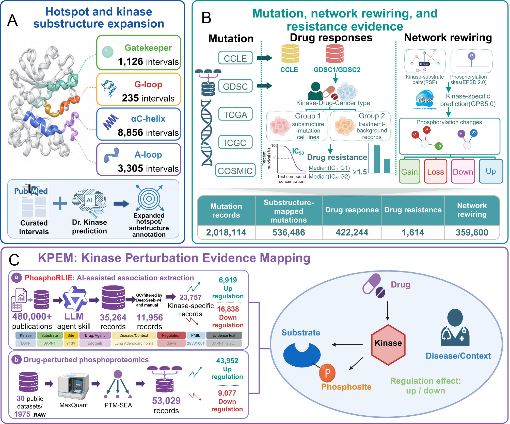

<h1 align="center">KinaseMD 2.0</h1>

<p align="center"><strong>在哪里查人类激酶突变及其药物反应？</strong></p>

<p align="center">
  
  <a href="https://doi.org/10.1093/nar/gkag1170"></a>
</p>

<p align="center"><a href="./README.md">English</a> · <strong>简体中文</strong></p>

<p align="center">
  <a href="http://modinfor.com/KinaseMD/">进入数据库</a> ·
  <a href="#egfr-example">EGFR 示例</a> ·
  <a href="#coverage">数据覆盖</a> ·
  <a href="#citation">引用方式</a>
</p>

**KinaseMD 2.0** 是一个公开查询人类激酶突变及其药物反应的数据库。它把癌症相关体细胞突变、结构注释、细胞系药物反应和磷酸化信号证据关联到同一激酶页面。论文发表的 2.0 版本覆盖 547 种人类蛋白激酶，收录 422,244 条细胞系药物反应测量。 [Nucleic Acids Research 论文](https://doi.org/10.1093/nar/gkag1170)

<p align="center">
  <a href="./assets/figure-1.jpg"></a>
</p>

<p align="center">
  <em>图 1. KinaseMD 2.0 的三个数据整合流程。</em> © 2026 论文作者。
  <a href="https://doi.org/10.1093/nar/gkag1170">Hu 等，Nucleic Acids Research</a> ·
  <a href="https://creativecommons.org/licenses/by-nc/4.0/">CC BY-NC 4.0</a>
</p>

<a name="egfr-example"></a>

## 如何查激酶突变的结构位置和药物反应？

在 KinaseMD 2.0 中搜索基因符号（如 **EGFR**），可在同一详情页查看突变的结构位置和细胞系药物反应。

1. 在 **Substructures** 和 **Mutations** 中查看突变位置及其对应的结构区域。KinaseMD 2.0 注释了四类与耐药相关的区域，分别是 gatekeeper 位点、甘氨酸富集环（G-loop）、αC 螺旋（αC-helix）和活化环（A-loop）。
2. 在 **Drug response** 中查看细胞系实验测得的半数抑制浓度（IC₅₀）。**Drug resistance** 中的候选耐药关联来自特定细胞系比较，可用于提出待验证的耐药假设。
3. 在 **Drug perturbation** 中查看相关的文献报告和药物处理磷酸化蛋白质组数据，并通过来源标识符回溯原始研究。

以 **EGFR T790M** 为例，数据库将其定位到 gatekeeper 位点。论文案例比较了携带 L858R/T790M 的 NCI-H1975 和携带 L858R 的 NCI-H3255，结合 GDSC2 的药物反应数据和 [PXD004373](https://proteomecentral.proteomexchange.org/cgi/GetDataset?ID=PXD004373) 的厄洛替尼（erlotinib）处理数据，展示如何交叉查看结构、药敏和信号证据。解读时需考虑两条细胞系的背景差异。 [论文图 4 与案例说明](https://doi.org/10.1093/nar/gkag1170)

## 如何追溯用药后的磷酸化变化？

KinaseMD 2.0 的 **Drug perturbation** 模块可按激酶追溯药物处理后的磷酸化变化。激酶扰动证据映射（Kinase Perturbation Evidence Mapping，KPEM）整合了两个来源。 [NAR 论文](https://doi.org/10.1093/nar/gkag1170)

- **文献报告。** 查看原文报道的激酶活性或激酶特异性磷酸化变化，并用 PMID 回查药物、样本与实验条件。
- **磷酸化蛋白质组。** 从公开药物处理实验的磷酸化位点测量中推断激酶相关信号变化，并用 ProteomeXchange 的 PXD 编号查找原始数据。位点测量值和相应的激酶推断具有不同的证据含义。

## 如何查突变可能影响的激酶–底物关系？

KinaseMD 2.0 的 **Network-rewiring** 模块提供突变相关的磷酸化倾向预测，可用于筛选后续实验要验证的底物或位点。查看结果时，可同时记录激酶、底物、磷酸化位点和预测变化方向。 [NAR 论文](https://doi.org/10.1093/nar/gkag1170)

<a name="coverage"></a>

## 数据覆盖范围

以下统计对应 NAR 论文报告的 KinaseMD 2.0 版本。 [论文表 1 和表 2](https://doi.org/10.1093/nar/gkag1170)

| 数据层 | 记录数 | 说明 |
| --- | ---: | --- |
| 人类蛋白激酶 | 547 | 每种参考激酶至少有一类结构区域注释 |
| 激酶结构区域注释 | 13,522 | 含 1,161 条来源整理注释和 12,361 条 Dr. Kinase 预测 |
| 癌症相关体细胞突变记录 | 2,018,114 | 其中 536,486 条映射到至少一个已注释的结构区域 |
| 细胞系药物反应测量 | 422,244 | 包含 219 种药物的 IC₅₀ 记录 |
| 候选耐药证据 | 1,614 | 基于细胞系药物反应比较得到的候选关联 |
| 磷酸化网络重连预测 | 359,600 | 反映突变相关的磷酸化倾向变化 |
| 文献报告的扰动证据 | 23,757 | 经人工复核的文献条目整理为激酶层级记录 |
| 磷酸化蛋白质组推断的信号反应 | 53,029 | 来自 30 个公开药物处理数据集 |

## 怎样查询和下载数据？

从[数据库首页](http://modinfor.com/KinaseMD/)进入浏览、常规搜索、批量搜索或高级搜索。处理后的数据可在 **Download** 页面获取。文献证据下载还包含仅通过自动质控的候选记录，可通过复核状态和置信度字段识别，并用 PMID 查阅原文。论文的补充教程提供了针对不同研究问题的查询流程。 [论文补充材料](https://academic.oup.com/nar/advance-article/doi/10.1093/nar/gkag1170/9036065#supplementary-data)

<a name="citation"></a>

## 如何引用 KinaseMD 2.0？

使用 KinaseMD 2.0 时，请引用数据库论文。在报告具体实验结果时，可同时列出该记录关联的原始研究或数据集编号。

Hu X, Lin S, Fu S, Zeng J, Xu Z, Zheng T, Wang T, Liu X, Huang P, Li Z, Liu T, Xu H. KinaseMD 2.0: an updated database of kinase mutations and drug response. *Nucleic Acids Research*. 2026; gkag1170. [doi:10.1093/nar/gkag1170](https://doi.org/10.1093/nar/gkag1170). [PubMed](https://pubmed.ncbi.nlm.nih.gov/43016064/)

```bibtex
@article{Hu2026KinaseMD2,
  author  = {Hu, Xiaojiang and Lin, Shaofeng and Fu, Shiyang and Zeng, Jing
             and Xu, Zhenmu and Zheng, Tao and Wang, Tao and Liu, Xinyi
             and Huang, Peng and Li, Zhihong and Liu, Tang and Xu, Haodong},
  title   = {{KinaseMD 2.0}: an updated database of kinase mutations and drug response},
  journal = {Nucleic Acids Research},
  year    = {2026},
  pages   = {gkag1170},
  doi     = {10.1093/nar/gkag1170},
  url     = {https://doi.org/10.1093/nar/gkag1170}
}
```

## 相关资源

- [KMD2 核心分析代码](https://github.com/Smallriver2024/KMD2)
- [PhosphoRLIE 文献证据提取流程](https://github.com/Smallriver2024/phosphorlie-skill)
